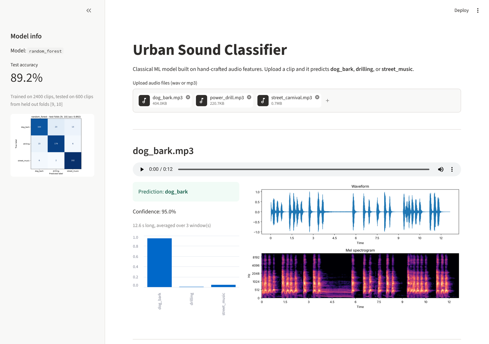
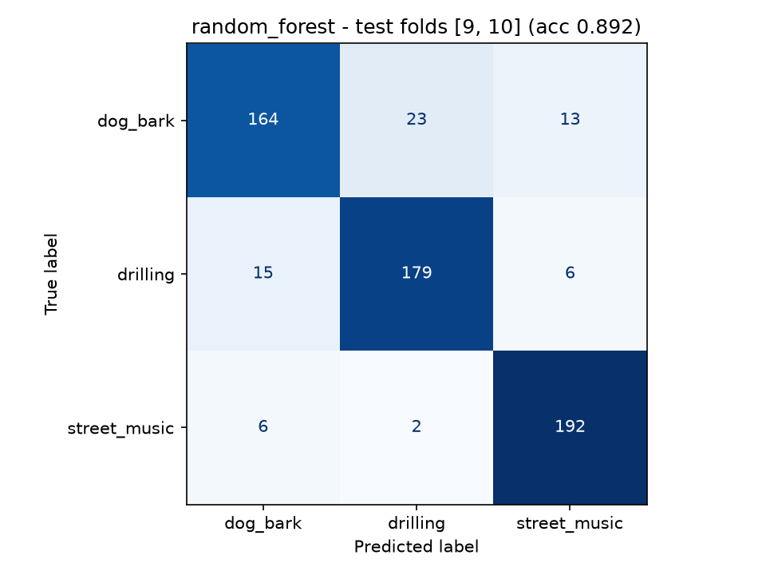
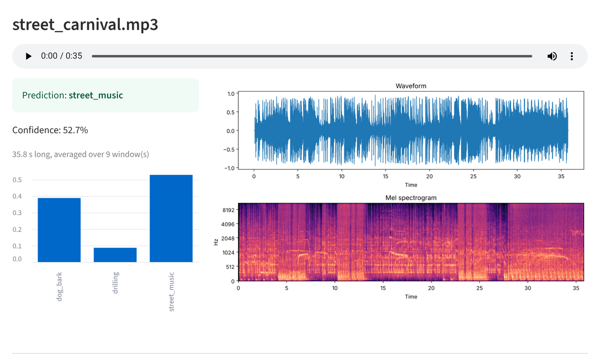
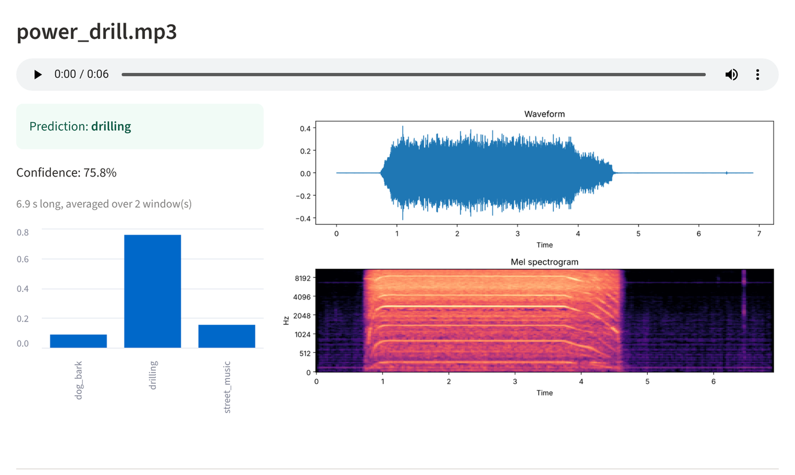
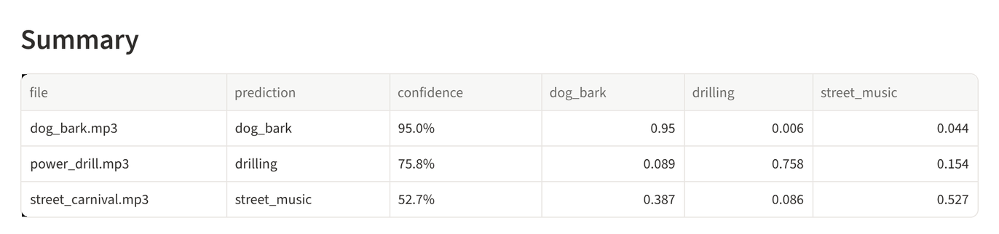

# Urban Sound Classifier

A classical machine learning model that classifies short audio clips as **dog bark**, **drilling**, or **street music**, deployed as an interactive Streamlit app. There is no deep learning here. Each clip is converted into 151 hand-built audio features with librosa, and a scikit-learn model is trained on those features.

**Live demo: [urban-sounds-classifier.streamlit.app](https://urban-sounds-classifier.streamlit.app)**

To try it, download the three recordings in [`samples/`](samples) and upload them to the app.



## What it does

- Extracts time, frequency, and cepstral features from each clip
- Compares three classifiers using cross validation grouped by recording fold
- Saves the best model and serves it in a Streamlit app
- In the app you can upload any WAV or MP3, play it back, see its waveform and mel spectrogram, and get a prediction with class probabilities

## Data

The model is trained on a three-class subset of [UrbanSound8K](https://urbansounddataset.weebly.com/urbansound8k.html): 1,000 clips each of `dog_bark`, `drilling`, and `street_music`, 3,000 clips total. Clips are up to 4 seconds long and come pre-assigned to 10 folds.

The dataset is not included in this repo. See [Running it locally](#running-it-locally) for how to download and prepare it.

## Features (151 per clip)

Every clip is loaded as mono at 22,050 Hz, trimmed of leading and trailing silence, and peak normalized so the model learns the type of sound rather than how loud the recording was. Frame-level features are then summarized over the clip with their mean (and standard deviation where useful).

| Domain | Feature | Values |
|---|---|---|
| Cepstral | 40 MFCCs, mean and std | 80 |
| Cepstral | MFCC deltas, mean | 40 |
| Frequency | Spectral centroid, bandwidth, roll-off, flatness, mean and std | 8 |
| Frequency | Spectral contrast (7 bands), mean | 7 |
| Frequency | Chroma (12 pitch classes), mean | 12 |
| Time | Zero crossing rate and RMS energy, mean and std | 4 |
| | **Total** | **151** |

MFCCs describe the overall timbre of a sound. The deltas, spectral flatness, and zero crossing rate were added mainly to separate drilling, which is a steady and noisy signal, from dog barks, which are short and change quickly.

## Why I split by fold instead of randomly

UrbanSound8K cuts each original field recording into several short slices, and all slices from the same recording are placed in the same fold. With a random train/test split, slices from one recording end up on both sides, so the model is tested on sounds it has basically already heard and the accuracy looks better than it really is.

To avoid that leakage:

- Folds 1 to 8 (2,400 clips) are used for training
- Folds 9 and 10 (600 clips) are held out as the test set
- Model selection uses leave-one-fold-out cross validation on the 8 training folds, so every validation fold is also made of recordings the model has not seen

This gives a lower number than a random split would, but it is a much more honest estimate of how the model handles new recordings.

## Model comparison

Each model is a scikit-learn pipeline with a `StandardScaler` in front, so scaling is only ever fit on training data.

| Model | Leave-one-fold-out CV accuracy |
|---|---|
| **Random forest** (400 trees) | **90.6%** (± 2.5%) |
| SVM, RBF kernel (C = 10) | 89.0% (± 2.3%) |
| K-nearest neighbors (k = 7) | 81.5% (± 3.0%) |

The random forest had the best cross validation score, so it was retrained on all 8 training folds and evaluated once on the held-out folds.

## Results

**Test accuracy on folds 9 and 10: 89.2%** (600 clips)

| Class | Precision | Recall | F1 |
|---|---|---|---|
| dog_bark | 0.886 | 0.820 | 0.852 |
| drilling | 0.877 | 0.895 | 0.886 |
| street_music | 0.910 | 0.960 | 0.934 |



Street music was the easiest class, with 192 of 200 clips correct. Most of the errors came from **dog barks and drilling being confused with each other**: 23 dog barks were predicted as drilling and 15 drilling clips were predicted as dog barks. Both tend to be loud, sharp bursts with a lot of high frequency energy, so their summary statistics overlap. Street music is more tonal and spread out over time, which the chroma and MFCC features pick up well.

### Longer recordings

The training clips are 4 seconds or shorter, but real uploads can be much longer. The app splits any longer file into 4 second windows, classifies each window, and averages the probabilities, so the model always sees input that looks like what it was trained on. On three longer test recordings (7 to 36 seconds, included in `samples/`) it got all three right:

| File | Prediction | Confidence |
|---|---|---|
| Dog barking (12.6 s) | dog_bark | 95.0% |
| Power drill (6.9 s) | drilling | 75.8% |
| Street carnival (35.8 s) | street_music | 52.7% |

The street carnival recording was the least certain (dog_bark was second at 38.7%) because it mixes crowd noise and percussion hits into the music, and those short, sharp sounds look a lot like barks to the features.



The power drill clip has about a second of silence on each end, but the drill itself shows up clearly as steady horizontal bands in the spectrogram, which is the kind of pattern the spectral flatness and MFCC features pick up on.





### What I would try next

- A CNN on mel spectrograms, or a pretrained audio model, to better separate dog barks from drilling
- Dimensionality reduction (PCA or SVD) on the 151 features, since many of them overlap
- Full 10-fold cross validation for the final reported score instead of a single held-out split

## Running it locally

Requires Python 3.11 or newer.

```bash
git clone https://github.com/the2fye/urban-sound-classifier.git
cd urban-sound-classifier
python -m venv .venv
source .venv/bin/activate        # Windows: .venv\Scripts\activate
pip install -r requirements.txt
```

**Run the app.** The trained model is already in `model/`, so no training is needed:

```bash
streamlit run app.py
```

**Retrain from scratch (optional).** Download UrbanSound8K from the [dataset page](https://urbansounddataset.weebly.com/urbansound8k.html), unzip it into the project folder, then:

```bash
python prepare_data.py --src UrbanSound8K --out UrbanSound_Filtered
python train_model.py --data UrbanSound_Filtered
```

Feature extraction takes a few minutes the first time and is cached to `model/features.csv` after that. Training prints the cross validation scores and test report, and writes a new model, `metrics.json`, and confusion matrix to `model/`.

## Project structure

```
app.py              Streamlit app: upload audio, see plots and predictions
features.py         Feature extraction shared by training and the app
train_model.py      Feature caching, model comparison, final training and evaluation
prepare_data.py     Builds the 3-class subset from the full UrbanSound8K download
model/
  audio_model.joblib    Trained pipeline (scaler + random forest)
  metrics.json          CV scores, test accuracy, classification report
  confusion_matrix.png  Confusion matrix on the held-out folds
samples/            Three longer recordings to test the app with
docs/               Screenshots used in this README
```

## Tech

Python, librosa, scikit-learn, NumPy, pandas, Matplotlib, Streamlit

## Dataset credit

J. Salamon, C. Jacoby and J. P. Bello, "A Dataset and Taxonomy for Urban Sound Research," 22nd ACM International Conference on Multimedia, Orlando, USA, Nov. 2014. UrbanSound8K is released under the CC BY-NC 3.0 license.
